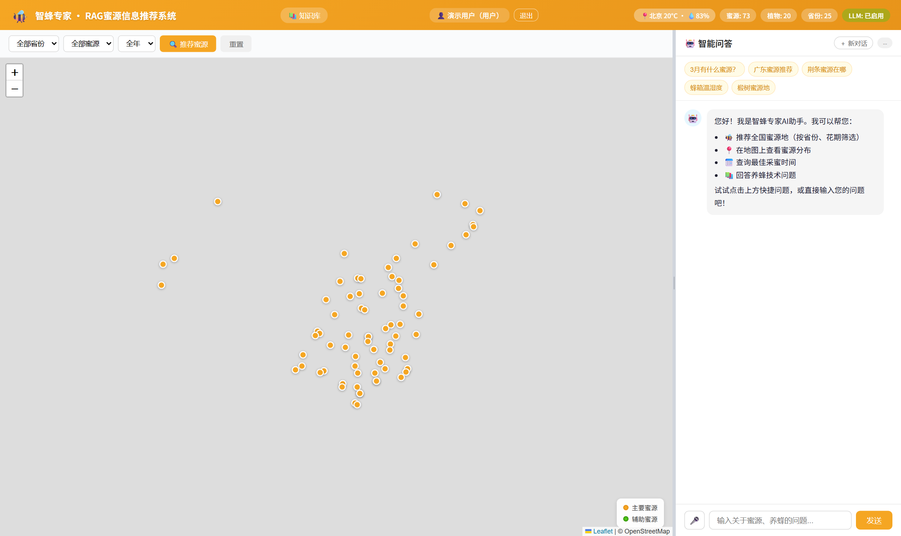
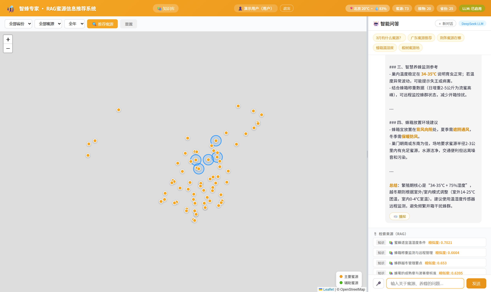
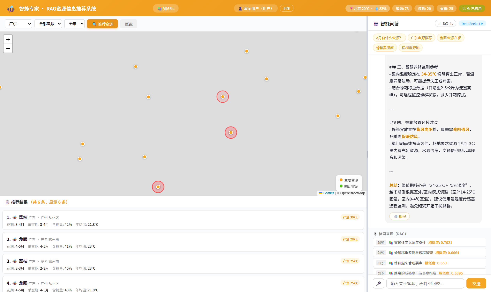
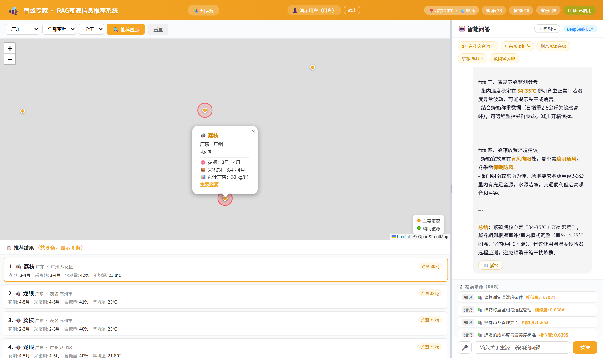
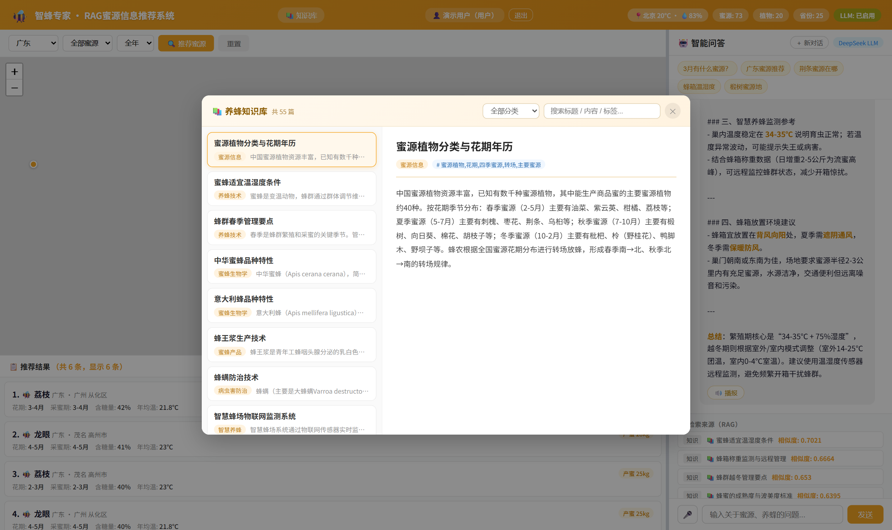
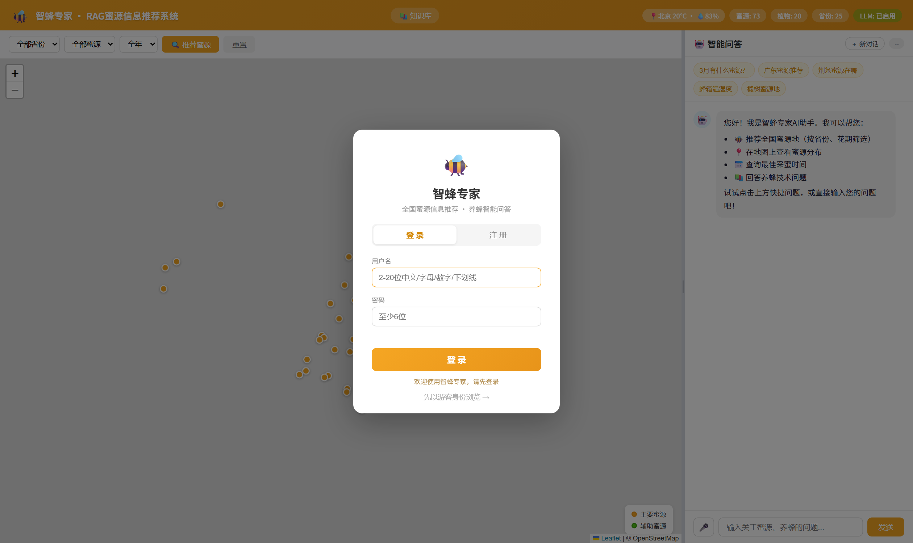

# 智蜂专家 · RAG 蜜源信息推荐系统

> 面向蜂农与养蜂技术人员的智能问答 + 蜜源推荐系统：以 **MySQL 结构化蜜源库 + Chroma 向量库 + DeepSeek 大模型** 为核心的检索增强生成（RAG）应用。

---

## 项目简介

本系统将零散的蜜源植物资料（分布、花期、产蜜量、气候等）与养蜂知识组织为可检索知识库，
通过 **混合检索（SQL 结构化筛选 + 向量语义排序）** 召回相关内容，再由大模型生成准确、可追溯的回答，
并标注信息来源。前端提供对话问答、蜜源推荐、地图分布、知识库浏览等能力。

## 功能特性

- **智能问答（RAG）**：结合检索资料生成回答，支持多轮对话与查询重写（指代消解）。
- **蜜源推荐**：按省份 / 月份 / 植物名筛选并智能排序推荐。
- **地图可视化**：全部蜜源点地理分布一键渲染。
- **知识库管理**：后台可增删知识条目，自动增量同步向量库，无需重启。
- **Token 用量统计**：记录每一次对话的输入 / 输出 / 总 token 消耗（见 `chat_token_log` 表）。
- **LLM 评测**：内置 LangSmith 评测脚本，量化回答正确率与来源召回率。

## 界面预览

| 主界面（问答 + 筛选 + 地图） | 多轮对话与来源标注 |
| --- | --- |
|  |  |

| 蜜源推荐结果 | 蜜源详情 |
| --- | --- |
|  |  |

| 知识库浏览 | 登录 |
| --- | --- |
|  |  |

## 系统架构

```
浏览器 (templates/index.html)
        │  HTTP / SSE
        ▼
Flask 后端 (app.py :5000)
        ├── 混合检索：MySQL 结构化筛选 + Chroma 向量语义排序 (rag_engine.py)
        ├── 答案生成：DeepSeek / OpenAI 兼容接口（含查询重写、流式输出）
        └── 数据层：MySQL (bee_rag) + Chroma 持久化向量库 (vector_db/)
```

## 三个服务与启动方式

| 服务 | 端口 | 启动脚本 | 说明 |
| --- | --- | --- | --- |
| 主系统（RAG 问答 / 蜜源推荐 / 地图） | 5000 | `start_app.bat` | 依赖 MySQL `bee_rag` + 本地向量库 |
| 蜂产品溯源系统 | 5001 | `start_trace.bat` | 依赖 MySQL `bee_trace`，演示码 `BF-20260830-39G6U8` |
| 蜜源环境融合评估（BP + 改进 D-S） | 5002 | `start_fusion.bat` | 启动时训练 3 个 BP 网络，约 10 秒后就绪 |

三个服务互相独立，可以只启动需要的那个。主系统顶部工具栏的「🔍 溯源查询」「🌡️ 环境评估」按钮
会分别连接 5001 / 5002，所以点击之前请先启动对应脚本。

启动脚本会自动探测可用的 Python 解释器（优先级：`.venv` → 本机 Python → PATH 上的 `python` / `py`）
并检查依赖是否安装，缺失时会直接提示需要执行的 `pip install` 命令，不会一闪而过。

> 注意：`.bat` 文件必须以 **UTF-8 带 BOM** 保存（脚本内 `chcp 65001` 切换了代码页）。
> 若用编辑器另存为「UTF-8 无 BOM」，cmd 会把后续行读串，表现为窗口一闪就关或找不到 `.py` 文件。

## 目录结构

```
rag_system/
├── app.py                      # Flask 后端主程序（API + 页面）
├── rag_engine.py               # RAG 引擎：检索 / 向量化 / 答案生成
├── init_db.py                  # 建库建表 + 灌数据（一条命令搞定）
├── expand_knowledge.py         # 进阶知识条目（init_db 会自动引用）
├── requirements.txt            # Python 依赖
├── start_app.bat               # 主系统一键启动（5000，含 HF 镜像设置）
├── start_trace.bat             # 溯源系统一键启动（5001）
├── start_fusion.bat            # 融合评估一键启动（5002）
├── templates/index.html        # 前端单页
├── static/                     # 前端 JS / CSS
├── data/                       # 原始数据（蜜源 / 知识）
├── docs/                       # 项目主页（GitHub Pages）+ 评测流程文档 + 截图
├── evals/                      # LangSmith 评测脚本、gold 数据集、两个验证实验
├── exports/                    # 数据导出 CSV（给外部平台导入用）
├── teammate_modules/           # 队友子系统：traceability（5001）/ bp_ds_fusion（5002）
├── models/                     # 本地 Embedding 模型（自动下载，已 gitignore）
└── vector_db/                  # Chroma 向量库（自动构建，已 gitignore）
```

## 环境要求

- Python 3.10+
- MySQL 8.0（数据库 `bee_rag`，账号密码见 `.env`）
- 可访问的 DeepSeek / OpenAI 兼容 LLM 接口

## 安装与运行（clone 下来 4 步跑起来）

前提：Python 3.10+、MySQL 8.0（本地或远程均可）、一个可用的 DeepSeek / OpenAI 兼容 API Key。

```bash
# 1. 克隆并装依赖
git clone <your-repo-url>
cd rag_system
pip install -r requirements.txt

# 2. 一条命令建库、建表、灌数据（73 条蜜源 + 55 篇知识，幂等可重复执行）
python init_db.py

# 3. 配置密钥：复制样例后填 LLM_API_KEY
cp .env.example .env

# 4. 启动
python app.py            # 或 Windows 下双击 start_app.bat
#   浏览器访问 http://127.0.0.1:5000
```

> **首次启动会慢一点**：自动下载本地向量模型（约 100 MB，`start_app.bat` 已设国内镜像 `hf-mirror.com`），
> 再把 128 篇文档向量化落盘到 `vector_db/`，约 1–2 分钟；之后重启直接加载，无需重建。
> 这一步已实测通过：空数据库 → `init_db.py` → 启动，系统自动建出 128 条向量并正常回答。

**两个子系统另需一次初始化：**

```bash
# 溯源（5001）：建表 + 灌演示数据
mysql -u root -p < teammate_modules/traceability/trace_schema.sql
python teammate_modules/traceability/seed_demo_data.py

# 融合评估（5002）：无需数据库，启动时自动训练 BP 网络
python teammate_modules/bp_ds_fusion/fusion_app.py
```

> **为什么 `models/` 和 `vector_db/` 不在仓库里**：它们是**可再生的派生物**——模型能自动下载，
> 向量库能从 MySQL 一键重建（`POST /api/vector/rebuild`）。提交进来只会让仓库凭空多出 143 MB，
> 而且换 embedding 模型后就作废了。同理 `.env` 含真实密钥，用 `.env.example` 代替。这是 RAG 项目的标准做法。

## 配置说明

| 配置项 | 说明 | 默认值 |
| --- | --- | --- |
| `LLM_API_KEY` | LLM 接口密钥（**必填**） | 无 |
| `LLM_API_URL` / `LLM_MODEL` | OpenAI 兼容接口地址与模型名 | DeepSeek |
| `EMBEDDING_PROVIDER` | `local`（离线）/ `api`（硅基流动） | `local` |
| `AUTH_ENABLED` | 是否启用登录鉴权 | `true` |
| `SECRET_KEY` | 会话签名密钥 | 随机串 |
| `MYSQL_*` | 数据库连接信息 | 本地 `root/123456` |
| `LANGSMITH_API_KEY` | 评测用（可选） | 无 |

## API 概览

| 方法 | 路径 | 说明 |
| --- | --- | --- |
| POST | `/api/chat` | 非流式问答（含多轮历史） |
| POST | `/api/chat/stream` | 流式问答（SSE 打字机） |
| POST | `/api/recommend` | 蜜源推荐 |
| GET | `/api/map` | 地图数据 |
| GET | `/api/knowledge` | 知识库列表 |
| GET | `/api/token/log` | 对话 token 用量统计 |
| POST | `/api/vector/rebuild` | 全量重建向量库（管理员） |

## LangSmith 评测

系统内置两套评测脚本，使用 **LLM-as-Judge** 量化回答质量：

```bash
# 在 .env 中配置 LANGSMITH_API_KEY 后
python evals/evaluate_rag_langsmith.py --dry-run            # 本地自检（不联网）
python evals/evaluate_rag_langsmith.py                      # 单轮评测
python evals/evaluate_rag_multiturn_langsmith.py            # 多轮（查询重写）评测
```

评测产出两个指标：`correctness`（事实正确性 0~1）与 `has_sources`（是否检索到来源）。
历史实验示例：单轮 correctness 0.82、has_sources 1.00；多轮指代消解 0.925。
脚本**不内置任何明文密钥**，全部从环境变量或 `.env` 读取。

评测目录 `evals/` 还包含两个可独立运行的验证实验：

| 脚本 | 作用 |
| --- | --- |
| `evals/query_rewrite_check.py` | 打印多轮追问被重写成了什么查询 |
| `evals/semantic_assembly_check.py` | 对比"裸字段名 / 无语义数值 / 中文语义组装"的余弦相似度 |

## 部署说明

- 本仓库的 **GitHub Pages 仅作为项目主页 / 文档**（静态页面，见 `docs/index.html`）。
  GitHub Pages **无法运行 Flask 后端**，真正可访问的产品需将后端部署到云服务器 / 容器平台。
- 推荐：将三服务（主系统 5000 / 溯源 5001 / 评估 5002）容器化后部署到云主机，并绑定域名。
- 安全提醒：`.env` 含真实密钥，已被 `.gitignore` 忽略，请勿手动 `git add .env`；
  若密钥曾提交过，请立即在对应平台吊销重置。

## 许可证

本项目仅供学习与演示使用。
